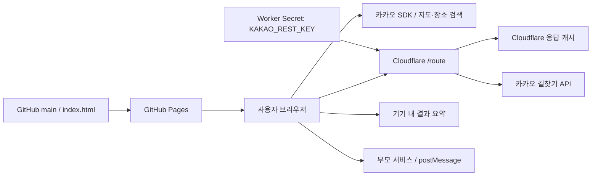
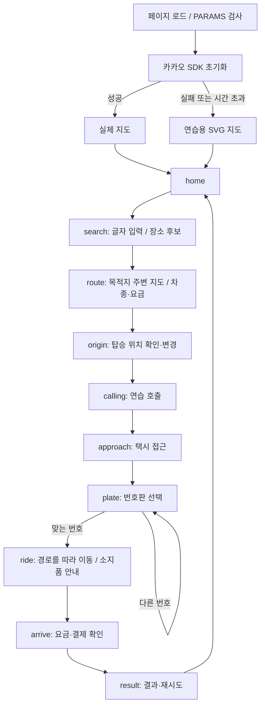
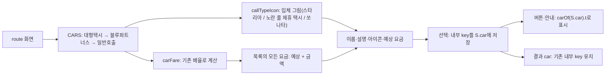
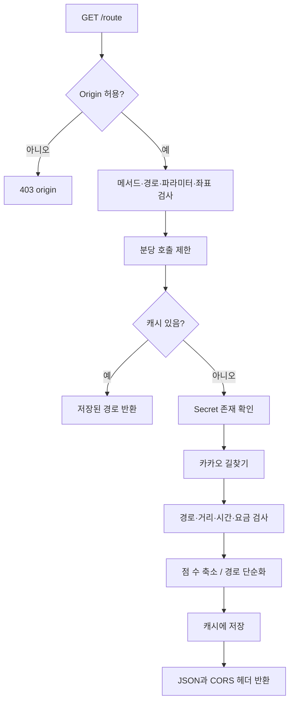
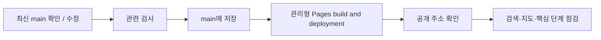
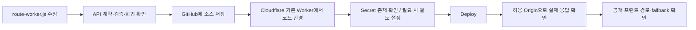

# PIPELINE.md — 배프 택시 실행·연결·배포 파이프라인

이 문서는 현재 구현된 흐름과 담당자가 수행할 운영 절차를 구분한다. 작업 원칙은 [AGENTS.md](AGENTS.md)를 먼저 읽는다.

소스 확인 기준: 커밋 b81322a로 처음 작성, 2026-11-11에 main과 다시 대조.
이 문서 작성은 자동 배포 시스템을 새로 설치한 작업이 아니다. 현재 프런트는 GitHub Pages가 배포하고, Worker는 담당자가 별도로 배포한다.

## 1. 전체 구성



| 구간 | 담당 | 현재 상태 |
|---|---|---|
| 소스 저장·프런트 배포 | GitHub 저장소 관리자 | 관리형 Pages 작업 이력 확인 |
| 지도·장소 검색 | 카카오 앱 관리자 | 브라우저 JavaScript SDK 사용 |
| 실제 경로·요금 | Cloudflare 관리자 | Worker 소스 존재, 별도 배포 필요 |
| 회원·학습 기록·예약 | 본 서비스 연결 담당자 | 이 저장소에는 인증·DB·예약 서버 없음 |
| 메시지 수신·다음 화면 | 부모 페이지 담당자 | 연결 시 구현·검증 필요 |

코드 검토만으로 현재 Cloudflare 운영 코드와 GitHub 소스가 같다고 단정하지 않는다. 운영 확인에는 Worker 배포 버전과 실제 응답을 사용한다.

## 2. 사용자 실행 파이프라인



모든 호출·탑승·결제 단계는 연습이다. 단계가 바뀔 때 이전 타이머·음성·검색 응답이 다음 단계에 영향을 주지 않아야 한다.

### 2.1 입력·검색

1. input/composition 이벤트가 현재 검색어를 반영한다. Enter 제출을 기다리지 않는다.
2. PlaceSearch가 관련된 기존 후보를 즉시 표시하고 100ms 뒤 카카오 장소 검색을 요청한다.
3. SDK 응답에서 장소명·주소·좌표를 검증하고 현재 요청 id/검색어/검색 화면과 맞는지 확인한다.
4. 결과 없음이면 앞 두 글자로 보완 검색한 후 이름·주소에 현재 입력이 들어 있는 후보만 남긴다.
5. 미완성 한글과 공백은 placeNorm/placeMatches로 비교한다. 관련 캐시 후보를 빈 응답 때문에 지우지 않는다.
6. 후보를 누르면 PlaceSearch.item으로 현재 목록 소속인지 확인한다. 도착지 선택과 탑승 위치 선택은 S.originSearch에 따라 분기한다.

### 2.2 경로·요금

1. routeData가 현재 출발점에 맞는 사전 경로나 S.live 응답을 찾는다.
2. 없으면 refreshLive → fetchRoute → askRoute → Worker를 호출한다.
3. 기본 장소는 key로, 검색 장소는 국내 좌표로 보낸다. 소수 3자리 격자에서 길을 못 찾으면 프런트의 주변 격자 재시도 경로가 적용될 수 있다.
4. 유효한 최신 응답만 반영한다. 목적지나 출발점이 바뀌었다면 옛 응답을 버린다.
5. 배차 접근 경로는 fetchApproach가 주변 택시의 위치부터 탑승 위치까지 별도로 조회한다.
6. 실패하면 곡선·저장 경로 조정·어림 요금을 사용해 연습을 계속한다. 검색한 장소는 어림값이라고 화면에 알려 주고, 기본 장소 10곳은 따로 알리지 않는다.
7. makeTrack/runAlong이 이동 위치와 방향을 계산하고, KakaoMap·SvgMap이 택시 앞을 진행 방향으로 돌린다.

### 2.3 호출 종류 선택·그림·요금 표시



| UI 이름 | 설명 | 내부 key | 연습 요금 계산 |
|---|---|---|---|
| 대형택시 | 여럿이 탈 때 | 대형 | 기준값 × 1.8, 기존 반올림 |
| 블루파트너스 | 배차될 때까지 찾아주는 제휴 택시 | 모범 | 기준값 × 1.6, 기존 반올림 |
| 일반호출 | 주변 택시 호출 | 일반 | 기준값 그대로 |

기본 선택은 일반호출이다. 배열의 첫 번째인 대형택시가 자동 선택되는 것은 아니다. 실제 배차·상품 API와 연결된 것이 아니라 기존 연습 모델의 화면 이름을 바꾼 것이다. 요금 배율·연습 차량·번호판·결과 필드 변경을 이번 UI 변경에 포함하지 않는다.

선택용 SVG는 index.html 안의 callTypeIcon에서 생성하므로 추가 이미지 자산 배포는 필요 없다. 좁은 화면·큰 글씨에서는 아이콘 옆의 이름·예상 요금·설명이 세 줄로 재배치된다. 후보 이름 텍스트와 버튼 터치 영역은 유지한다.

이번 변경의 배포 대상은 프런트뿐이다. Worker 코드·Secret·CORS·카카오 도메인 설정 변경 및 Worker 재배포는 필요하지 않다.

## 3. Worker 요청 처리 파이프라인



### 3.1 요청 계약

- 엔드포인트: GET /route
- 파라미터는 from, to를 각각 한 번만 사용한다.
- from: 위도,경도 문자열. 예: 37.256,127.067
- to: 기본 장소 key(예: ajou) 또는 위도,경도 문자열.
- 좌표는 위도 소수 3자리, 경도 소수 3자리 형식을 지켜야 한다.
- 소스 검증 범위: 위도 33~39, 경도 124~132. 두 점 간 거리가 50m 미만이면 거부한다. 이 범위는 정밀한 국경 판정이 아니다.
- 브라우저 origin 허용 목록: https://baepu-team.github.io, http://127.0.0.1:5500.
- 카카오 API에는 경도,위도 순서로 전달한다. 프런트 및 응답 path의 위도,경도 순서와 다르다.
- 클라이언트에서 REST 키 또는 Authorization 헤더를 전달하지 않는다.

정상 응답 예시(형식 설명용 값):

```json
{
  "path": [[37.256, 127.067], [37.280, 127.047]],
  "m": 3800,
  "s": 840,
  "taxi": 7600
}
```

| 필드 | 의미 |
|---|---|
| path | 위도·경도 쌍의 배열, 최소 2개 |
| m | 거리, 미터 |
| s | 소요 시간, 초 |
| taxi | 택시 요금, 원 |

### 3.2 응답·제한

| 상태 | 소스의 오류 값 | 확인할 것 |
|---|---|---|
| 400 | point | 형식·중복 파라미터·국내 범위·너무 가까운 두 점 |
| 403 | origin | Worker 허용 origin과 실제 iframe 문서 주소 |
| 404 | path | URL 끝 /route |
| 405 | method | GET 사용 여부 |
| 429 | rate | 호출량, retry-after 60초 |
| 503 | key | Worker Secret 존재 여부 |
| 502 | upstream / route | 카카오 통신·응답·도로 경로 존재 여부 |

- 제한은 소스상 IP당 분당 20회, Worker 인스턴스 전체 분당 240회다. 인스턴스별 메모리 방식이므로 전 세계에 걸친 엄격한 쿼터는 아니다.
- 캐시는 일주일 TTL로 저장하며 응답 Cache-Control은 1일이다. x-route-cache는 hit/miss다.
- 응답 경로는 최대 점 수를 줄인 후 단순화한다. 원본 도로 vertex 전체와 동일한 정밀도를 보장하지 않는다.
- 새 Worker는 Secret이 없어도 이전 캐시를 사용할 수 있는 경우와 캐시 미스인 경우가 다를 수 있다. 정상 요청 하나만으로 Secret 설정 전체를 단정하지 않는다.
- CORS는 인증을 대체하지 않는다. 시범 운영의 좌표 허용 범위·이용량 정책은 운영 규모가 바뀔 때 검토한다.

## 4. 본 서비스 연결 파이프라인

### 4.1 현재 주소를 링크로 열기

기존 URL로 이동한다. 소스 이전과 서버 재배포는 필요하지 않다. 단, 다른 도메인 탭에서 연 페이지는 현재 코드의 window.parent 기반 iframe 메시지 통합과 다르다. 링크 이동만으로 부모 서비스가 결과를 자동 수신한다고 설명하지 않는다.

### 4.2 현재 주소를 iframe으로 넣기

담당자는 부모 사이트 origin을 먼저 정한다. 아래 https://service.example은 설명용이며 실제 서비스 주소로 바꿔야 한다.

1. 택시 index.html의 CONFIG.PARENT_ORIGIN을 실제 부모 origin으로 설정한다.
2. 부모 페이지에 iframe을 넣고 메시지 수신기를 설치한다.
3. 현재 위치·음성 입력을 사용할 경우 해당 브라우저 기능 허용과 사용자 동의를 확인한다.
4. 기본·완료·중단·공유 거부/동의·예약·나가기를 각각 점검한다. 공유·예약 버튼은 기본 연습이나 mode=test의 결과 화면에서만 나온다(mode=practice 결과에는 없다). 아래 예시의 mode=practice로는 이 둘을 점검할 수 없다.

부모 페이지 예시:

```html
<iframe
  id="taxi-practice"
  title="배프 택시 부르기 연습"
  src="https://baepu-team.github.io/kimhyoeun-redesign/?mode=practice"
  allow="geolocation; microphone"
  style="display:block;width:100%;height:100dvh;border:0"
></iframe>
<script>
const frame = document.getElementById('taxi-practice');
const childOrigin = 'https://baepu-team.github.io';
const accepted = new Set([
  'baepu:practice-result',
  'baepu:practice-share',
  'baepu:practice-book',
  'baepu:practice-exit'
]);
window.addEventListener('message', event => {
  if (event.origin !== childOrigin) return;
  if (event.source !== frame.contentWindow) return;
  const data = event.data;
  if (!data || typeof data !== 'object') return;
  if (data.kind !== 'taxi' || !accepted.has(data.type)) return;
  // 여기서 type별로 필요한 필드를 검증한 뒤
  // 본 서비스의 저장·화면 이동·예약 요청 처리에 연결한다.
  // 이 예제 자체에는 DB 저장이나 예약 실행 기능이 없다.
});
</script>
```

부모는 postMessage의 값을 신뢰된 서버 기록으로 바로 저장하지 않는다. 현재 로그인 사용자와 연결하고 필드 유형·범위·중복 요청을 검증하는 것은 부모 서비스의 역할이다. GitHub Pages의 같은 origin에는 여러 경로가 있으므로 event.source 검사도 유지한다.

### 4.3 메시지 계약

| type | 언제 전달되는가 | 부모 담당 작업 |
|---|---|---|
| baepu:practice-result | 완료 또는 중단 | 결과 검증·회원 연결·필요 시 DB 저장 |
| baepu:practice-share | 자녀 공유 동의 후 | 동의 범위 안에서 공유 요청 처리 |
| baepu:practice-book | 다음 수업 예약 버튼 | 예약 페이지 연결 또는 요청 처리 |
| baepu:practice-exit | 나가기 처리 | iframe 닫기·원래 페이지 이동 |

결과 메시지 주요 필드:

| 필드 | 내용 |
|---|---|
| kind | taxi |
| mode | practice 또는 test |
| mission / dest | 미션 또는 목적지 key, 없으면 null |
| car | 기존 내부 key: 일반 / 모범 / 대형. 화면 이름은 아래 매핑 참고 |
| success / solo | 완료 여부 / 혼자 성공 여부 |
| score | 완료한 test일 때 점수, 그 외 null |
| sec / hints / mist | 경과 초 / 힌트 / 실수 |
| stuckAt / recommend | 막힌 단계와 추천 수업 |
| steps | search, fare, origin, car의 상세 기록 |
| fare / finishedAt | 요금 / ISO 날짜 문자열 |

부모 서비스가 결과의 car를 표시할 때는 일반→일반호출, 모범→블루파트너스, 대형→대형택시로 매핑한다. 화면 이름이 바뀌어도 이번 버전에서 전송되는 key는 변경되지 않았다. 외부 저장 스키마를 새 이름으로 자동 마이그레이션하지 않는다.

steps의 각 값은 ok, mic, moved, hints, mist, guided, sec를 갖는다. ok는 단계에 따라 true/false/null이다. score를 모든 화면에서 표시하는 UI 점수로 가정하지 않는다.

공유 메시지에는 현재 코드상 result 요약(mode, success, solo, sec, hints, stuckAt, finishedAt)만 전달한다. 예약 메시지에는 topic/stuckAt, 나가기에는 kind/type가 전달된다. 탑승 위치 좌표는 결과에 포함시키지 않는다.

iframe이 아니어도 페이지에 window.onBaepuPracticeResult 함수가 정의돼 있으면 result·share·book을 그 함수로도 넘기고, 이때도 공유·예약 버튼이 나온다. exit는 postMessage로만 보낸다.

동적 dest key는 세션의 장소를 가리킨다. 부모가 장소명이나 지리 정보를 영구 보관해야 한다면 추가 필드·동의·저장 범위를 먼저 합의한다. 현재 메시지에 장소명과 좌표가 항상 들어 있다고 가정하지 않는다.

### 4.4 프런트를 새 도메인으로 옮길 때

| 설정 | 값의 기준 |
|---|---|
| 카카오 JavaScript SDK 허용 도메인 | 새 택시 페이지의 origin |
| CONFIG.ROUTE_API | 새 택시 페이지 hostname에서도 서버 URL이 활성화되도록 조건 수정 |
| Worker ALLOWED_ORIGINS | 새 택시 페이지 origin을 허용 후 Worker 배포 |
| CONFIG.PARENT_ORIGIN | 결과를 받는 부모 서비스 origin |
| 부모 iframe src·childOrigin | 새 택시 페이지 URL·origin |

기존 URL을 iframe으로 넣는 경우에는 부모 도메인을 Worker 허용 목록에 무조건 추가하지 않는다. 경로 요청을 보내는 주체는 iframe 문서다.

## 5. 프런트 배포 파이프라인

### 현재 운영



1. index.html과 필요한 문서를 수정한다.
2. JavaScript 구문, 외부 입력 처리, 영향 단계와 화면 크기를 점검한다.
3. 변경 범위를 확인하고 main에 저장한다.
4. GitHub Actions의 pages build and deployment 작업이 성공했는지 확인한다.
5. 공개 URL에서 최신 변경이 실제로 보이는지 확인한다. 커밋 저장 성공만으로 배포 완료를 보고하지 않는다.
6. 브라우저 캐시 때문에 이전 화면이 보이면 새로고침·새 탭으로 비교한다.

문서 작성 시 저장소에는 자체 workflow YAML이 없다. 자동 구문 검사·브라우저 테스트는 현재 배포 과정에 이미 구현되어 있다고 주장하지 않는다. 앞으로 CI를 추가할 때 필요한 권한과 배포 방식은 별도 변경으로 검토한다.

## 6. Worker 배포 파이프라인



1. 기존 운영 Worker와 소스의 차이를 확인한다. Secret 값은 출력하지 않는다.
2. 요청 형식·응답 단위·기존 key 호환성을 확인한 코드를 저장한다.
3. Cloudflare의 기존 baepu-route에 해당 코드를 반영하고 Deploy한다. GitHub 커밋만으로 끝내지 않는다.
4. Secret KAKAO_REST_KEY가 필요한 환경에 설정되어 있는지 확인한다. 새 Worker는 기존 Secret을 자동 상속하지 않는다.
5. 기존 장소 key와 검색 좌표에 대해 정상 응답을 확인한다.
6. 잘못된 좌표·Origin·fallback·호출 제한을 필요한 범위에서 확인한다. 무의미한 부하 테스트는 하지 않는다.
7. Worker 주소가 바뀌었다면 프런트 ROUTE_API도 함께 배포한다.

Wrangler를 쓰는 자동 배포 구성은 현재 저장소에 없다. 자동화를 추가하려면 계정·Worker 매핑, 최소 권한 배포 자격 증명, Secret 관리, 검증·실패 시 중단 정책을 먼저 정해야 한다.

## 7. 검증 완료 기준

| 영역 | 통과 기준 |
|---|---|
| 검색 | Enter 없이 갱신, 두 글자→세 글자 이상에서도 관련 후보 유지 |
| 선택 | 목록 후보와 목적지 이름·주소·핀 위치 일치 |
| 호출 목록 | 대형택시→블루파트너스→일반호출, 상세 설명·세 아이콘 일치, 모든 목록 금액에 예상 표시 |
| 호출 선택 | 선택 버튼은 UI 이름으로 갱신, 기본·미션은 일반호출, 결과 key와 배율 유지 |
| 아이콘 반응형 | 폰 프레임 너비 360px 이하·큰 글씨에서 요금·설명 잘림 없음, 지도·번호판 그림 영향 없음 |
| 출발 | 기기 위치·검색 출발지·핀 이동이 목적지와 혼동되지 않음 |
| 경로 | 실제 응답 또는 설명된 fallback으로 연습 계속 |
| 택시 | 접근·탑승 후 주행·커브·도착 후 앞 방향 자연스러움 |
| 화면 | 390×844, 320×568 큰 글씨에서 버튼 접근 가능 |
| 모드 | 기본·practice·test&dest=ajou에서 단계·안내·기록 적절 |
| 권한 | 위치·마이크 거부해도 멈추지 않음 |
| 통합 | origin/source 검증, 완료·중단·공유·예약·나가기 처리 |
| 개인정보 | 결과에 탑승 위치가 없고 공유 전 동의 필요 |
| 운영 | 프런트와 Worker 각각의 반영 상태 확인 |

단순 문서 수정에 대해 위 기능을 모두 다시 시험했다고 보고하지 않는다. 수행한 검사와 남은 운영 확인을 분리해 적는다.

## 8. 장애 확인과 복구

| 증상 | 먼저 확인할 항목 |
|---|---|
| SVG 그림 지도로 바뀜 | JavaScript 키, SDK 도메인, 카카오맵 사용 설정, 네트워크·제한 시간 |
| 후보가 안 나옴 | SDK services, 검색 상태, 부분 일치, 요청 id, 네트워크 |
| 새 도메인에서 어림값만 나옴 | ROUTE_API 호스트 조건, Worker Origin, Worker 실제 배포·Secret |
| 결과가 부모에 안 옴 | PARENT_ORIGIN, 실제 부모 origin, parentAccepts, event.source |
| 음성·위치가 안 됨 | 사용자 권한, 브라우저 지원, iframe allow, HTTPS 등 실행 환경 |
| GitHub 저장했는데 서버가 그대로 | Worker 별도 배포 누락 |
| 프런트가 이전 화면 | Pages 작업 상태, 공개 파일·캐시 |
| 실제 경로 실패 | 응답 코드, 국내 좌표, 너무 가까운 두 점, 격자·도로 위치, 업스트림 |

프런트 복구: 문제가 된 변경을 Git에서 되돌려 main을 다시 배포하고 공개 화면을 확인한다.
Worker 복구: Cloudflare에서 직전 정상 버전을 복구하거나 검증된 이전 소스를 Deploy한다.
한쪽 롤백이 다른 쪽 롤백을 대신하지 않는다. API 계약을 함께 바꿨다면 호환 가능한 조합으로 복구한다. 장애 기록에 키·정확한 사용자 위치·녹음 등 개인정보를 남기지 않는다.

## 9. 인수인계 산출물

- 소스 ZIP: index.html, cloudflare/route-worker.js, AGENTS.md, PIPELINE.md, README.md.
- 호출 목록 변경분을 전달할 때는 코드와 문서를 같은 버전으로 묶고, 이전 전달용 ZIP과 구분한다.
- 기준 커밋, 현재 프런트 URL, Worker URL.
- 이번에 실제 배포한 대상과 미배포 대상.
- 연결할 부모 origin, 새 도메인 여부, iframe인지 링크인지.
- 실제로 검증한 브라우저·화면·단계와 알려진 제한.
- 계정 권한은 적절한 서비스 멤버 초대로 관리한다. Secret·비밀번호를 ZIP으로 전달하지 않는다.
